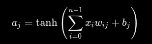

## теория
Количество нейронов определяет размер выхода слоя.
Количество весов одного нейрона определяется размером входа слоя.
Проще говоря, веса определяют, как входные данные влияют на нейрон, а смещение позволяет сдвигать его реакцию на эти данные.

## Цепочка передачи данных для змейки
GameEngine
    |
GameObservation
    |
double[] inputs
    |
NeuralNetwork

## Кратко о классах:
AIController.cs	- Преобразует решения нейросети в команды управления змейкой.
FitnessEvaluator.cs -	Вычисляет оценку эффективности нейросети (Fitness) на основе игровой статистики.
GameObservation.cs -	Анализирует игровое состояние и преобразует его в 11 входных признаков для нейросети.
GeneticAlgorithm.cs  -	Реализует генетические операторы скрещивания и мутации для эволюции нейросетей.
Genome.cs -	Представляет генетическую информацию нейросети в виде набора весов и смещений.
Individ.cs	- Представляет отдельную особь популяции, содержащую нейросеть и её оценку Fitness.
NeuralNetwork.cs -	Реализует полносвязную нейронную сеть с архитектурой 11 | 16 | 16 | 3 для принятия решений.
Population.cs - Управляет популяцией особей, участвующих в генетическом обучении.

## Входные значения для нейронки
Для входных значений используется класс GameObservation, она преобразовывает важные значение в 11 значный массив

## Входные значения

| № | Вход | Описание |
|---|---|---|
| 1 | DangerStraight | Опасность впереди |
| 2 | DangerRight | Опасность справа |
| 3 | DangerLeft | Опасность слева |
| 4 | MovingUp | Движение вверх |
| 5 | MovingDown | Движение вниз |
| 6 | MovingLeft | Движение влево |
| 7 | MovingRight | Движение вправо |
| 8 | FoodUp | Еда выше головы |
| 9 | FoodDown | Еда ниже головы |
| 10 | FoodLeft | Еда левее головы |
| 11 | FoodRight | Еда правее головы |

Все входные значения принимают значение **0 или 1**.

## Выходные значения

| № | Действие | Значение |
|---|---|---|
| 0 | Прямо | От -1 до 1 |
| 1 | Направо | От -1 до 1 |
| 2 | Налево | От -1 до 1 |

Нейронная сеть выбирает действие с максимальным выходным значением.

## Архитектура нейронки
Нейросеть является многослойным перцептроном - имеет входной, выходной и 2 скрытых слоев. Каждый нейрон одного слоя соединён с каждым нейроном следующего слоя, то есть полносвязные. 

Почему 3 выходных нейрона?
Здесь тоже есть конкретная причина.

Мы хотим, чтобы нейросеть могла выполнять три действия:
0 - двигаться прямо
1 - повернуть направо
2 - повернуть налево
Поэтому выходной слой содержит три нейрона.
Но важно понимать: выходные нейроны не выдают непосредственно команды. Например:
Выход №0: 0.21 — прямо
Выход №1: 0.85 — направо
Выход №2: 0.34 — налево

Некоторые решения требуют учитывать сочетания нескольких признаков, по этой причине нужны скрытые слои. Первый скрытый слой преобразует входные признаки в новые числовые представления. Второй скрытый слой комбинирует результаты первого. А выходной слой использует эту информацию для выбора действия. 

## Вхоной: 11 нейронов
## скрытый № 1: 16 нейронов
## скрытый № 2: 16 нейронов
## выходной: 3 нейронов

Количество параметров:
11 -> 16 + 16 -> 16 + 16 -> 3 + 3 
192 + 272 + 51 = 515 параметров 

Смещение (Bias) — это обучаемый параметр нейрона, который прибавляется к взвешенной сумме входных значений перед применением функции активации. Оно позволяет нейрону изменять порог своей активации независимо от входных данных.
Веса определяют, насколько сильно каждый признак влияет на нейрон, а смещение регулирует, при каком сочетании входных значений нейрон начнёт выдавать определённую реакцию.

| Обозначение | Значение |
|---|---|
| \(a_j\) | Результат работы нейрона с индексом `j` |
| \(\tanh\) | Функция активации |
| \(\sum\) | Суммирование |
| \(i\) | Индекс входного значения |
| \(n\) | Количество входов |
| \(x_i\) | Входное значение с индексом `i` |
| \(w_{ij}\) | Вес связи от входа `i` к нейрону `j` |
| \(b_j\) | Смещение нейрона `j` |

## Селекция нейронных сетей
Для селекции существует разные методы, но для задачи NeuronSnake выбор пал на Tournament Selection + Elitism.

Tournament Selection - Несколько случайных особей соревнуются между собой
Elitism - несколько лучших особей текущего поколения переходят в следующее поколение без изменения генома

## Пока что лучшие показатели
population = geneticAlgorithm.NextGeneration(population, 5, 5, 0.3, 0.1);
double fitness = 10*score + 0.00008 * steps;

## Actioner

Модель которая рассчитывает самую прибыльную выборку проектов, без учета риска(пока что)

60 -> 16 -> 20;

BudgetProblem
      |
ActionerObservation
      |
NeuralNetwork
      |
ActionerController
      |
ActionerState
      |
ActionerEvaluator
      |
  Fitness

## Рассчеты для Actioner

Projects = 20
у каждой из проектов 3 поля ch:
- Cost
- Profit
- SuccessProbability

для того что бы предотвратить перенасыщение нейронки будем характеристики следующим способом:
x1 = Cost/Budget
x2 = Profit/Cost
x3 = SuccessProbability

N_max = (20*3)

---

Мат ожидание результата одного проекта для оценщика:
res = prob*Profit - (1 - prob)*Cost
